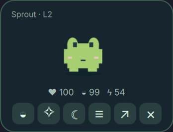
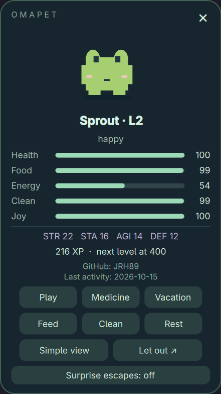
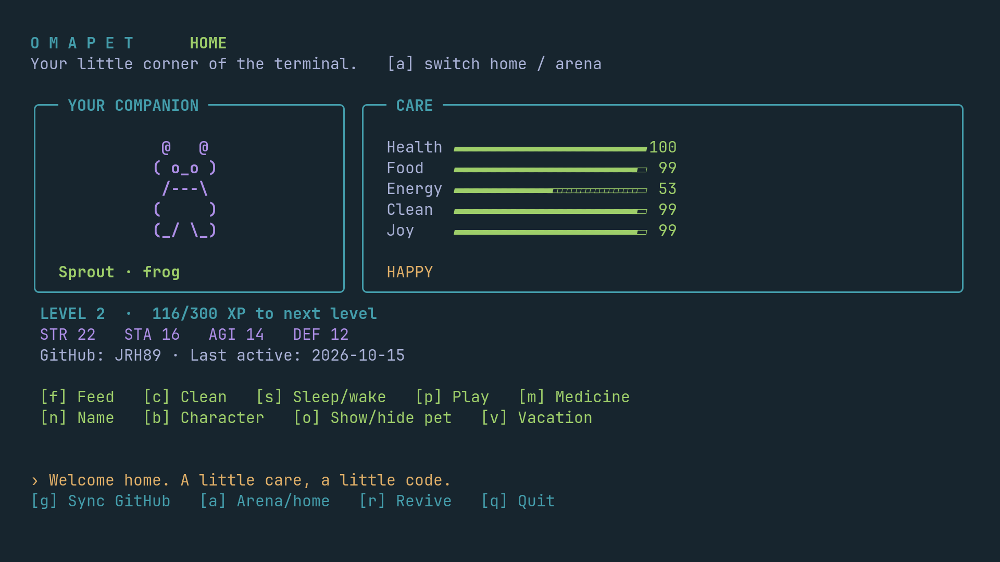

# Omapet

A desktop companion for **Omarchy Quattro**. Care for a tiny pet, help it grow
through GitHub contributions, and let it wander around your desktop.

Choose from eleven characters, name your companion, and keep it close in a compact
widget or terminal dashboard. GitHub activity earns experience; food, cleaning,
sleep, and play are up to you. Vacation mode pauses care when you need a break.

**Python 3.11+ · No pip dependencies · MIT licensed**

## Screenshots

<table>
  <tr><th>Compact habitat</th><th>Detailed habitat</th></tr>
  <tr>
    <td valign="top"></td>
    <td valign="top"></td>
  </tr>
</table>

### Terminal dashboard



All three images are actual screenshots of the running widget and TUI.

## Install

On **Omarchy Quattro**, use the normal plugin installer:

```sh
omarchy plugin add https://github.com/JRH89/omapet.git --enable
```

The widget runs its bundled Python helper directly. No build step, custom
installer, background service, or global `omapet` command is needed.

- **Left-click the bar widget** to open the TUI.
- **Right-click the bar widget** to show or hide the desktop pet.
- Press **n** in the TUI to name your pet, or **b** to choose its character.
- In the habitat, hover over an icon to see its label. **≡** opens detailed view.
- Drag the pet, header, or empty habitat space to move its home. Its position is saved.

The repository is the source for installation. A marketplace listing is a separate
submission; see [publishing status and instructions](PUBLISHING.md).

### Requirements

- Omarchy Quattro / Quickshell for the bar and desktop habitat.
- Python 3.11+ with curses, included in Arch's Python package.
- Omarchy's configured terminal launcher for the bar's TUI shortcut.
- Optional **GitHub CLI (`gh`)** for contribution XP.
- Optional **Waybar** for the JSON adapter, or a private server for arena battles.

You can care for your pet offline. GitHub authentication is only needed when you
choose to sync contributions. There is no telemetry or required hosted backend.

### Optional terminal command

To also run `omapet` from any terminal:

```sh
python3 ~/.config/omarchy/plugins/jrh89.omapet/scripts/install.py
```

This creates `~/.local/bin/omapet`; make sure that directory is on your PATH.
The helper refuses to overwrite an existing launcher. The widget and TUI work
without this optional step.

## A little care, a little code

| Feature | How it works |
| --- | --- |
| Eleven companions | Cat, fox, bunny, frog, bear, owl, slime, robot, penguin, snake, or gopher. Randomly assigned or chosen in the TUI. |
| Everyday care | Feed, clean, play, rest, and treat sickness. Animated snacks and bubbles confirm actions. |
| Compact or detailed | One row of icon buttons, or care meters, combat traits, XP, and GitHub activity. |
| Desktop adventures | Let your pet out and click it to bring it home. Optional surprise escapes happen while it is awake and healthy. |
| Time off | Vacation freezes care needs. Gentle mode prevents death; hardcore mode is opt-in. |
| Friendly battles | Connect to a private TUI arena for turn-based sparring and capped XP rewards. |

GitHub contributions build different strengths:

| Contribution | Training | XP each | Daily cap |
| --- | --- | ---: | ---: |
| Commit | Strength | 4 | 12 |
| Pull request opened | Stamina | 16 | 3 |
| Issue opened | Agility | 10 | 3 |
| Pull request review | Defense | 12 | 5 |

Sync reads the last seven UTC days and keeps daily high-water marks to prevent
repeat rewards. GitHub's contribution eligibility and visibility rules apply.
These are game signals, not a measure of engineering quality. Sleep and food
always come from care, and taking time off GitHub does not directly harm your pet.

To enable GitHub XP, install GitHub CLI if needed, run `gh auth login`, then press
**g** in the TUI. Omapet uses that existing authentication and does not save the
GitHub token or send it to an arena server. Sync is manual by default.

## Controls and guides

| TUI key | Action | TUI key | Action |
| --- | --- | --- | --- |
| **f** | Feed | **c** | Clean |
| **s** | Sleep / wake | **p** | Play |
| **m** | Medicine | **g** | Sync GitHub |
| **n** | Rename | **b** | Choose character |
| **o** | Show / hide pet | **v** | Vacation |
| **a** | Home / arena | **r** | Revive |
| **q** | Quit | | |

- [Care, progression, characters, roaming, and optional hourly sync](docs/GUIDE.md)
- [Private arena setup and battle rules](docs/ARENA.md)
- [Development, local installation, testing, and release archives](docs/DEVELOPMENT.md)
- [Marketplace publishing](PUBLISHING.md)

For **Waybar**, merge [the module configuration](integrations/waybar.jsonc), add
`custom/omapet` to your bar, and include [the styles](integrations/waybar.css).
The adapter uses the optional `omapet` launcher. The on-screen habitat still
requires the Quattro plugin; the standalone TUI does not.

The arena is an early feature for small, trusted groups. Combat is resolved on
the server, but clients supply their traits. It is not a ranked or cheat-resistant
service. See the arena guide before hosting it outside a trusted network.

## Update and remove

```sh
omarchy plugin update jrh89.omapet
omarchy plugin remove jrh89.omapet
```

Progress and preferences stay in `$XDG_DATA_HOME/omapet` (normally
`~/.local/share/omapet`). Use `OMAPET_HOME` for a separate pet or test instance.
Removing the plugin preserves this data.

If you installed the optional launcher, remove `~/.local/bin/omapet` separately.
Remove any Waybar module you added. If you enabled hourly sync, disable
`omapet-sync.timer` and remove its user service/timer files as described in the
care guide. No system-owned Omarchy files are modified.

## License

[MIT](LICENSE). The QML sprites and screenshot assets are included under the same license.
