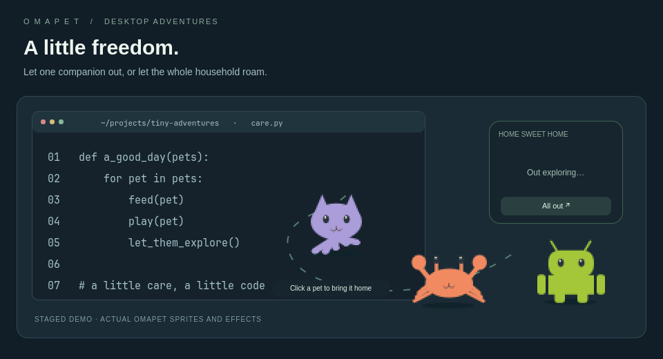
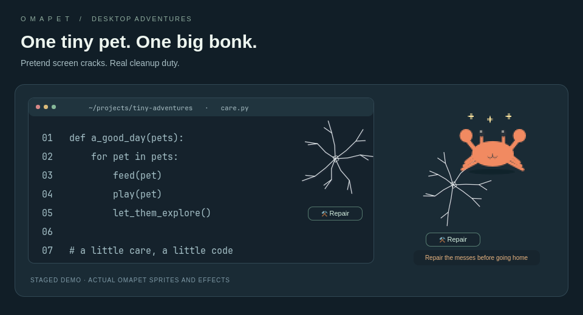
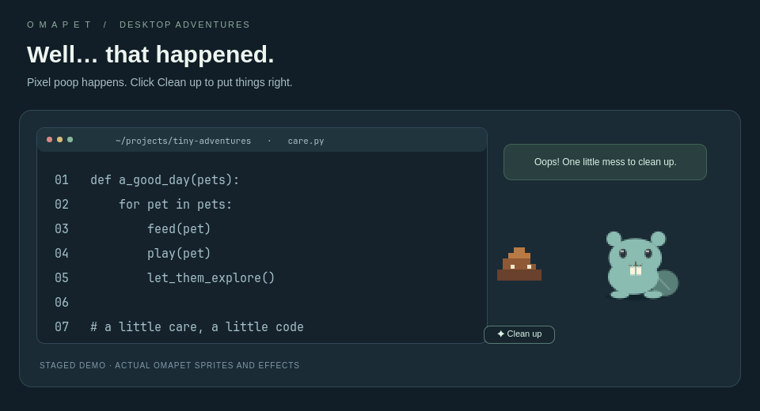
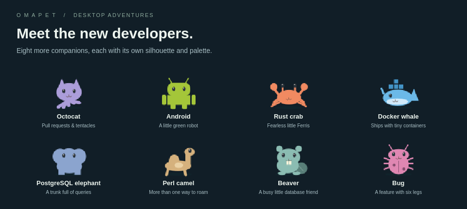
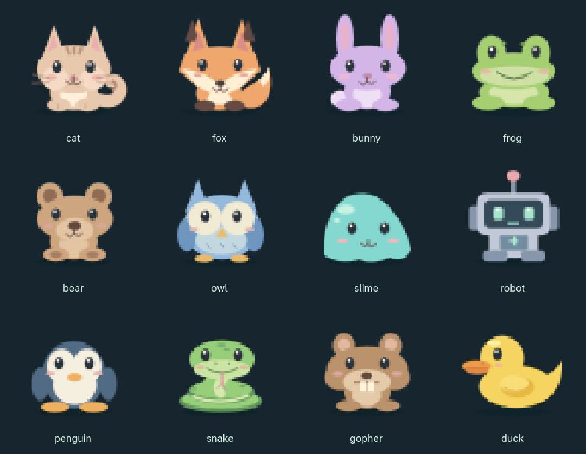

# Omapet

A desktop companion for **Omarchy Quattro**. Collect tiny pets, help them grow
through everyday care and GitHub contributions, and let them wander around your desktop.

Choose from **20 characters** and keep up to **24 pets**, each with its own name,
needs, XP, and trained stats. Play together, spar locally, or take two-pet teams
into a private online arena. Put pets up for adoption or trade a high-level
companion to a friend—their progress goes with them. Vacation pauses care when
you need a break.

**Python 3.11+ · No pip dependencies · MIT licensed**

## Screenshots

<table>
  <tr><th>Compact habitat</th><th>Detailed habitat</th></tr>
  <tr>
    <td valign="top"></td>
    <td valign="top"></td>
  </tr>
</table>

### Terminal dashboard


The habitat and terminal images above are screenshots of the running widget and TUI.

### Out of the habitat

Use **Let out ↗** for one pet or **All out** for the household. Awake, healthy pets
run around your screen; optional surprise escapes can happen too. Click a roaming
pet to bring it home after cleaning up any messes.



<table>
  <tr><th>Bonk! A pretend screen crack</th><th>Oops. Pixel poop.</th></tr>
  <tr>
    <td valign="top"></td>
    <td valign="top"></td>
  </tr>
</table>

Click **Repair** on cracks and **Clean up** on poop. These are cosmetic desktop
effects; they do not damage your screen or files. Up to four messes can appear,
and your pet waits for cleanup before coming home.

*The adventure images are staged demo scenes rendered with Omapet's actual sprites,
run/bonk poses, crack effects, and cleanup controls. The example editor, habitat
placeholder, and arrangement are for the demo; your apps stay underneath the pets.*

## Install

On **Omarchy Quattro**, use the normal plugin installer:

```sh
omarchy plugin add https://github.com/JRH89/omapet.git --enable
```

The widget runs its bundled Python helper directly. No build step, custom
installer, background service, or global `omapet` command is needed.

- **Left-click the bar widget** to open the TUI.
- **Right-click the bar widget** to show or hide the desktop pet.
- Press **n** in the TUI to name your pet, or **b** to choose its character.
- Press **k** for your collection and exchange board, **h** to hatch, or **Tab** to switch pets.
- In the habitat, hover over an icon to see its label. **≡** opens detailed view.
- Drag the pet, header, or empty habitat space to move its home. Its position is saved.
- Preview a cosmetic pet screensaver from Detailed view. [Enable it for idle time](docs/GUIDE.md#pet-screensaver).

The repository is the source for installation. A marketplace listing is a separate
submission; see [publishing status and instructions](PUBLISHING.md).

### Requirements

- Omarchy Quattro / Quickshell for the bar and desktop habitat.
- Python 3.11+ with curses, included in Arch's Python package.
- Omarchy's configured terminal launcher for the bar's TUI shortcut.
- Optional **GitHub CLI (`gh`)** for contribution XP.
- Optional **Waybar** for the JSON adapter, or a private server for arena battles.

You can care for your pet offline. GitHub authentication is only needed when you
choose to sync contributions. There is no telemetry or required hosted backend.

### Optional terminal command

To also run `omapet` from any terminal:

```sh
python3 ~/.config/omarchy/plugins/jrh89.omapet/scripts/install.py
```

This creates `~/.local/bin/omapet`; make sure that directory is on your PATH.
The helper refuses to overwrite an existing launcher. The widget and TUI work
without this optional step.

## A little care, a little code

| Feature | How it works |
| --- | --- |
| Twenty companions | Twelve original pets plus octocat, Android, Rust crab, Docker whale, PostgreSQL elephant, Perl camel, Beaver, and a bug. |
| Pet collection | Keep up to 24 pets with separate names, needs, levels, and training. Press **k** in the TUI. |
| Adoption and trading | List pets on a connected private arena. Adopt for free or exchange pets; XP and trained stats travel with them. |
| Everyday care | Feed, clean, play, rest, and treat sickness. Animated snacks and bubbles confirm actions. |
| Compact or detailed | One row of icon buttons, or care meters, combat traits, XP, and GitHub activity. |
| Desktop adventures | Let one pet or the household roam. Surprise escapes, bonks, screen cracks, and pixel poop keep things lively. Click messes to repair or clean up. |
| Time off | Vacation freezes care needs. Gentle mode prevents death; hardcore mode is opt-in. |
| Friendly battles | Local 1v1/2v2 sparring and online battles with one or two pets per player. Online rewards are capped. |
| Care progression and moods | Useful care earns XP; low joy causes loneliness and sadness with visible expressions. |

### Developer-inspired companions

The eight new pets join the original cat, fox, bunny, frog, bear, owl, slime,
robot, penguin, snake, gopher, and rubber duck. Each has a distinct desktop sprite
and terminal portrait.



| Companion | Inspired by | Character ID |
| --- | --- | --- |
| Octocat | GitHub's cat-and-octopus mascot | `octocat` |
| Android | The little green Android robot | `android` |
| Rust crab | Ferris and the Rust community | `crab` |
| Docker whale | Containers on a tiny whale | `whale` |
| PostgreSQL elephant | The database elephant | `elephant` |
| Perl camel | Perl's camel mascot | `camel` |
| Beaver | Database tooling, with a nod to [DBeaver](https://dbeaver.io/) | `beaver` |
| Bug | Every developer's recurring visitor | `bug` |

Press **h** to hatch one in the TUI, or run `omapet pets hatch crab --name Ferris`.
Changing an existing pet's character with **b** is cosmetic and keeps its progress.
These are Omapet's own stylized drawings, not official mascot artwork.

<details>
<summary>See all 20 companions</summary>



</details>

### Growth through care and code

Useful feeding, cleaning, play, medicine, and an hour of sleep each earn **12 XP**,
up to **120 care XP per pet per UTC day**. Care rewards have cooldowns, so repeating
an action on an already comfortable pet does not farm XP. Levels improve combat
traits, making offline care a way to grow stronger too.

Low joy now shows up as **lonely** or **sad**, including visible expressions.
Play restores joy; food, rest, cleaning, and medicine handle the other needs.
Sleeping no longer hides sickness. See the [care guide](docs/GUIDE.md#progress-that-makes-sense)
for thresholds and reward rules.

GitHub contributions build different strengths:

| Contribution | Training | XP each | Daily cap |
| --- | --- | ---: | ---: |
| Commit | Strength | 4 | 12 |
| Pull request opened | Stamina | 16 | 3 |
| Issue opened | Agility | 10 | 3 |
| Pull request review | Defense | 12 | 5 |

Sync reads the last seven UTC days and keeps daily high-water marks to prevent
repeat rewards. GitHub's contribution eligibility and visibility rules apply.
These are game signals, not a measure of engineering quality. Sleep and food
always come from care, and taking time off GitHub does not directly harm your pet.

To enable GitHub XP, install GitHub CLI if needed, run `gh auth login`, then press
**g** in the TUI. Omapet uses that existing authentication and does not save the
GitHub token or send it to an arena server. Sync is manual by default.

## Controls and guides

| TUI key | Action | TUI key | Action |
| --- | --- | --- | --- |
| **f** | Feed | **c** | Clean |
| **s** | Sleep / wake | **p** | Play |
| **m** | Medicine | **g** | Sync GitHub |
| **n** | Rename | **b** | Choose character |
| **o** | Show / hide pet | **v** | Vacation |
| **a** | Home / arena | **r** | Revive |
| **k** | Collection / exchange | **h** | Hatch a pet |
| **Tab** | Next pet | **q** | Quit |

- [Care, progression, characters, roaming, and optional hourly sync](docs/GUIDE.md)
- Try offline battles with `omapet arena demo`, or press **d** in the TUI Arena. No pet stats change.
- [Arena welcome page](https://arena.codefrontlabs.com) — invite-only pilot and join instructions.
- [Private arena setup and battle rules](docs/ARENA.md)
- [Hosting, backups, and tunnel isolation](docs/HOSTING.md)
- [Development, local installation, testing, and release archives](docs/DEVELOPMENT.md)
- [Marketplace publishing](PUBLISHING.md)

For **Waybar**, merge [the module configuration](integrations/waybar.jsonc), add
`custom/omapet` to your bar, and include [the styles](integrations/waybar.css).
The adapter uses the optional `omapet` launcher. The on-screen habitat still
requires the Quattro plugin; the standalone TUI does not.

Online adoption, trades, and 2v2 require an updated private arena server and
clients. Two-pet teams match other two-pet teams. Adoption is free; an open trade
accepts any living pet in return, so friends can exchange pets at different levels.
XP and trained stats transfer, while GitHub identities and contribution histories
stay with their household. [Collection and exchange guide](docs/GUIDE.md#your-household-adoption-and-trading).

The arena is an early feature for small, trusted groups. Combat is resolved on
the server, but clients supply their traits. It is not a ranked or cheat-resistant
service. See the arena guide before hosting it outside a trusted network.

## Update and remove

```sh
omarchy plugin update jrh89.omapet
omarchy plugin remove jrh89.omapet
```

Existing single-pet saves migrate automatically when you add a companion.

Progress and preferences stay in `$XDG_DATA_HOME/omapet` (normally
`~/.local/share/omapet`). Use `OMAPET_HOME` for a separate pet or test instance.
Removing the plugin preserves this data.

If you installed the optional launcher, remove `~/.local/bin/omapet` separately.
Remove any Waybar module you added. If you enabled hourly sync, disable
`omapet-sync.timer` and remove its user service/timer files as described in the
care guide. No system-owned Omarchy files are modified.

## License

[MIT](LICENSE). The QML sprites and screenshot assets are included under the same license.
